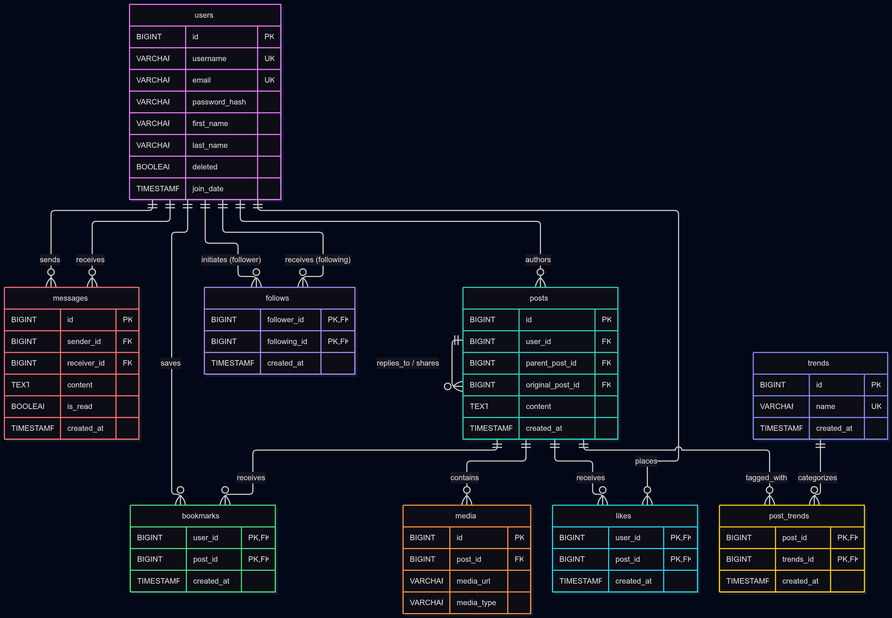

# Social Network Platform DATABASE

My Name: Ahmed Essam.

Video overview: https://youtu.be/UivDxz35WXI

## Scope

<!-- In this section you should answer the following questions: -->

- What is the purpose of your database?

  The purpose of this database is to model the core backend operations of a hybrid social networking platform combining elements of Twitter and Facebook. It handles user management, content posting, nested reply threads, media attachments, user engagement (likes, bookmarks), social graph connections (follows), direct private messaging, and trending hashtag tracking.

- Which people, places, things, etc. are you including in the scope of your database?

  Users: User profiles storing identity data (first_name, last_name, username, email, password_hash), biographical details (bio, location, date_of_birth), media URLs (profile_pic_url, background_pic_url), activity timestamps (join_date, last_login), and soft-deletion state (deleted)

  Content Graph: Textual and media content stored inside a unified posts table that natively represents standard posts, comment replies (via parent_post_id), and shares/reposts (via original_post_id).

  Media Attachments: External cloud storage URLs linked to posts.

- Which people, places, things, etc. are _outside_ the scope of your database?
  - Machine-learning recommendation algorithms (e.g., algorithmic "For You" feeds).

  - Account verification systems (e.g., blue checkmarks).

  - Group pages, public channels, or community spaces.

## Functional Requirements

- What should a user be able to do with your database?
  - Register an account with a unique username and email, edit profile and soft-delete their account.
  - Publish posts containing text, external media links, or both.
  - Comment on existing posts or create sub-replies within a thread using self-referencing relationships.
  - Share or quote-repost content created by other users.
  - Like, unlike, bookmark, or remove saved bookmarks from posts.
  - Follow or unfollow other accounts to build a personalized timeline feed.
  - Send direct private messages to other users and mark received messages as read.
  - Query top trending hashtags published within a rolling 24-hour time window.

- What's beyond the scope of what a user should be able to do with your database?
  - Users cannot create multi-admin "Pages" or "Groups."

  - Users Can't benefit from an algorithmic suggestions from the DATABASE. such as If a use enjoy following football news and transfers, The DATABASE can't help him/her by suggestion another users who are talking about football.

## Representation

### Entities

#### 1. `users`

Stores core user identity, credentials, and profile details.

| Attribute            | Data Type       | Constraints                     | Justification                                                                            |
| -------------------- | --------------- | ------------------------------- | ---------------------------------------------------------------------------------------- |
| `id`                 | `BIGINT`        | `AUTO_INCREMENT`, `PRIMARY KEY` | Scalable 64-bit unique identifier to handle long-term user growth.                       |
| `first_name`         | `VARCHAR(50)`   | `NOT NULL`                      | Standard name length cap avoiding unnecessary fixed storage.                             |
| `last_name`          | `VARCHAR(50)`   | `NOT NULL`                      | Standard surname length cap.                                                             |
| `username`           | `VARCHAR(30)`   | `NOT NULL`, `UNIQUE`            | Public handle used for profile routes and mentions.                                      |
| `email`              | `VARCHAR(255)`  | `NOT NULL`, `UNIQUE`            | Standard maximum email length RFC specification; enforces account uniqueness.            |
| `password_hash`      | `VARCHAR(255)`  | `NOT NULL`                      | Accommodates output lengths from modern secure hashing algorithms (e.g., bcrypt/Argon2). |
| `bio`                | `VARCHAR(160)`  | Optional (`NULL`)               | Matches Twitter's standard 160-character biography limit.                                |
| `location`           | `VARCHAR(100)`  | Optional (`NULL`)               | Flexible length for user-provided location text.                                         |
| `date_of_birth`      | `DATE`          | `NOT NULL`                      | Calendar birth date required for platform age compliance.                                |
| `profile_pic_url`    | `VARCHAR(2048)` | Optional (`NULL`)               | Safe maximum URL string length per RFC 2616 for external cloud storage objects.          |
| `background_pic_url` | `VARCHAR(2048)` | Optional (`NULL`)               | Safe maximum URL string length for profile banner images.                                |
| `join_date`          | `TIMESTAMP`     | `DEFAULT CURRENT_TIMESTAMP`     | Automatically records account creation time in UTC.                                      |
| `last_login`         | `TIMESTAMP`     | Optional (`NULL`)               | Updated dynamically during active session authentication events.                         |
| `deleted`            | `BOOLEAN`       | `DEFAULT 0`                     | Flag allowing soft deletion without violating foreign keys in external tables.           |

#### 2. `posts`

Unified table representing top-level posts, nested comment replies, and quote-shares.

| Attribute          | Data Type   | Constraints                          | Justification                                                                        |
| ------------------ | ----------- | ------------------------------------ | ------------------------------------------------------------------------------------ |
| `id`               | `BIGINT`    | `AUTO_INCREMENT`, `PRIMARY KEY`      | Unique 64-bit primary key for primary feed lookups.                                  |
| `user_id`          | `BIGINT`    | `NOT NULL`, `FK -> users(id)`        | Identifies the author (`ON DELETE CASCADE`).                                         |
| `content`          | `TEXT`      | Optional (`NULL`)                    | Stores up to 65,535 characters for long posts. Nullable to support media-only posts. |
| `parent_post_id`   | `BIGINT`    | Optional (`NULL`), `FK -> posts(id)` | Self-referencing key. Non-null values indicate a comment/reply to a target post.     |
| `original_post_id` | `BIGINT`    | Optional (`NULL`), `FK -> posts(id)` | Self-referencing key. Non-null values indicate a share or quote-repost.              |
| `created_at`       | `TIMESTAMP` | `DEFAULT CURRENT_TIMESTAMP`          | Records original publication time.                                                   |
| `updated_at`       | `TIMESTAMP` | `NULL ON UPDATE CURRENT_TIMESTAMP`   | Automatically updates whenever content text is modified.                             |

#### 3. `media`

Stores external cloud storage references for post attachments.

| Attribute    | Data Type       | Constraints                     | Justification                                                          |
| ------------ | --------------- | ------------------------------- | ---------------------------------------------------------------------- |
| `id`         | `BIGINT`        | `AUTO_INCREMENT`, `PRIMARY KEY` | Unique attachment identifier.                                          |
| `post_id`    | `BIGINT`        | `NOT NULL`, `FK -> posts(id)`   | Identifies the parent post (`ON DELETE CASCADE`).                      |
| `media_url`  | `VARCHAR(2048)` | `NOT NULL`                      | Direct URL link to stored file (prevents database BLOB storage bloat). |
| `media_type` | `VARCHAR(20)`   | `DEFAULT 'image'`               | Categorizes file format (e.g., `'image'`, `'video'`).                  |

#### 4. `likes` & `bookmarks`

Junction tables representing user engagement actions.

| Attribute    | Data Type   | Constraints                   | Justification                           |
| ------------ | ----------- | ----------------------------- | --------------------------------------- |
| `user_id`    | `BIGINT`    | `NOT NULL`, `FK -> users(id)` | Interacting user (`ON DELETE CASCADE`). |
| `post_id`    | `BIGINT`    | `NOT NULL`, `FK -> posts(id)` | Target post (`ON DELETE CASCADE`).      |
| `created_at` | `TIMESTAMP` | `DEFAULT CURRENT_TIMESTAMP`   | Timestamp of interaction.               |

- **Primary Key Constraint:** `PRIMARY KEY (user_id, post_id)` on both tables prevents duplicate likes or saves by the same user on a single post.

#### 5. `follows`

Directed graph table mapping user relationships.

| Attribute      | Data Type   | Constraints                   | Justification                                     |
| -------------- | ----------- | ----------------------------- | ------------------------------------------------- |
| `follower_id`  | `BIGINT`    | `NOT NULL`, `FK -> users(id)` | User initiating the follow (`ON DELETE CASCADE`). |
| `following_id` | `BIGINT`    | `NOT NULL`, `FK -> users(id)` | Target user being followed (`ON DELETE CASCADE`). |
| `created_at`   | `TIMESTAMP` | `DEFAULT CURRENT_TIMESTAMP`   | Connection creation timestamp.                    |

- **Constraints:** `PRIMARY KEY (follower_id, following_id)` prevents duplicate follows. `CONSTRAINT chk_no_self_follow CHECK (follower_id <> following_id)` prevents users from following themselves.

#### 6. `messages`

Direct private messaging between users.

| Attribute     | Data Type   | Constraints                     | Justification                            |
| ------------- | ----------- | ------------------------------- | ---------------------------------------- |
| `id`          | `BIGINT`    | `AUTO_INCREMENT`, `PRIMARY KEY` | Unique message ID.                       |
| `sender_id`   | `BIGINT`    | `NOT NULL`, `FK -> users(id)`   | Message sender (`ON DELETE CASCADE`).    |
| `receiver_id` | `BIGINT`    | `NOT NULL`, `FK -> users(id)`   | Message recipient (`ON DELETE CASCADE`). |
| `content`     | `TEXT`      | `NOT NULL`                      | Text body of private message.            |
| `is_read`     | `BOOLEAN`   | `DEFAULT FALSE`                 | Read status flag for UI unread counters. |
| `created_at`  | `TIMESTAMP` | `DEFAULT CURRENT_TIMESTAMP`     | Message dispatch timestamp.              |

#### 7. `trends` & `post_trends`

Hashtag catalog and post junction table.

| Entity            | Attribute    | Data Type      | Constraints                     | Justification                                          |
| ----------------- | ------------ | -------------- | ------------------------------- | ------------------------------------------------------ |
| **`trends`**      | `id`         | `BIGINT`       | `AUTO_INCREMENT`, `PRIMARY KEY` | Unique hashtag ID.                                     |
|                   | `name`       | `VARCHAR(100)` | `NOT NULL`, `UNIQUE`            | Unique hashtag string (e.g., `'#CS50'`).               |
|                   | `created_at` | `TIMESTAMP`    | `DEFAULT CURRENT_TIMESTAMP`     | First occurrence timestamp.                            |
| **`post_trends`** | `post_id`    | `BIGINT`       | `NOT NULL`, `FK -> posts(id)`   | Target post (`ON DELETE CASCADE`).                     |
|                   | `trends_id`  | `BIGINT`       | `NOT NULL`, `FK -> trends(id)`  | Linked hashtag (`ON DELETE CASCADE`).                  |
|                   | `created_at` | `TIMESTAMP`    | `DEFAULT CURRENT_TIMESTAMP`     | Link timestamp used for 24-hour velocity calculations. |

- **Primary Key Constraint:** `PRIMARY KEY (post_id, trends_id)` on `post_trends` prevents duplicate hashtag assignments to a single post.

---

### Relationships

| Parent Entity      | Child Entity  | Type      | Foreign Key Column(s)                          | On Delete | Purpose / Business Logic                               |
| ------------------ | ------------- | --------- | ---------------------------------------------- | --------- | ------------------------------------------------------ |
| `users`            | `posts`       | **1 : N** | `posts.user_id`                                | `CASCADE` | One user creates many posts.                           |
| `posts`            | `posts`       | **1 : N** | `posts.parent_post_id`                         | `CASCADE` | Self-reference: One post receives many replies.        |
| `posts`            | `posts`       | **1 : N** | `posts.original_post_id`                       | `CASCADE` | Self-reference: One post receives many shares/reposts. |
| `posts`            | `media`       | **1 : N** | `media.post_id`                                | `CASCADE` | One post holds multiple media URLs.                    |
| `users` & `posts`  | `likes`       | **M : N** | `likes.user_id`, `likes.post_id`               | `CASCADE` | Maps user post likes via junction key.                 |
| `users` & `posts`  | `bookmarks`   | **M : N** | `bookmarks.user_id`, `bookmarks.post_id`       | `CASCADE` | Maps user saved bookmarks via junction key.            |
| `users` & `users`  | `follows`     | **M : N** | `follows.follower_id`, `follows.following_id`  | `CASCADE` | Maps asymmetric directed follower graph.               |
| `users` & `users`  | `messages`    | **M : N** | `messages.sender_id`, `messages.receiver_id`   | `CASCADE` | Routes direct private communications.                  |
| `posts` & `trends` | `post_trends` | **M : N** | `post_trends.post_id`, `post_trends.trends_id` | `CASCADE` | Maps posts to parsed hashtag entities.                 |

<!-- In this section you should answer the following questions: -->

<!-- * Which entities will you choose to represent in your database?
* What attributes will those entities have?
* Why did you choose the types you did?
* Why did you choose the constraints you did? -->

### Relationships

<!-- In this section you should include your entity relationship diagram and describe the relationships between the entities in your database. -->

## Optimizations

| Index Name                  | Target Table  | Indexed Column(s)                             | Purpose & Optimization Logic                                                                                      |
| --------------------------- | ------------- | --------------------------------------------- | ----------------------------------------------------------------------------------------------------------------- |
| `idx_posts_user_created`    | `posts`       | `user_id`, `created_at DESC`                  | Accelerates user profile feed generation and timeline ordering without full table scans.                          |
| `idx_posts_parent`          | `posts`       | `parent_post_id`                              | Speeds up comment thread loading when retrieving all replies attached to a given post.                            |
| `idx_messages_conversation` | `messages`    | `sender_id`, `receiver_id`, `created_at DESC` | Optimizes private chat history lookups between two specific users in chronological order.                         |
| `idx_messages_unread`       | `messages`    | `receiver_id`, `is_read`                      | Accelerates badge notification queries counting unread direct messages for a recipient.                           |
| `idx_post_trends_window`    | `post_trends` | `created_at DESC`, `trends_id`                | Speeds up time-window filtering for calculating trending hashtag volume over recent time frames (e.g., 24 hours). |

<!-- In this section you should answer the following questions: -->

<!-- - Which optimizations (e.g., indexes, views) did you create? Why? -->

## Limitations

- The Absence of Machine learning techniques. Machine learning nowadays is critical to know user preferences So his/her news feed will be mostly contained what he/she loves and follow. such as: facebook pages suggestion, youtube channels or videos suggestion ... etc.
  <!-- In this section you should answer the following questions: -->
  <!-- - What are the limitations of your design?
<!-- - What might your database not be able to represent very well? --> -->

## Tools I used

- Docker: to create mysql Server.
- VSCode: I used an extension to connect to my docker container & VSCode is very helpful in code intellisense.
- GEMINI: to help my write my Document cause it's better than my in English. (English is not my native language & I'm not good enough at representing my ideas).
